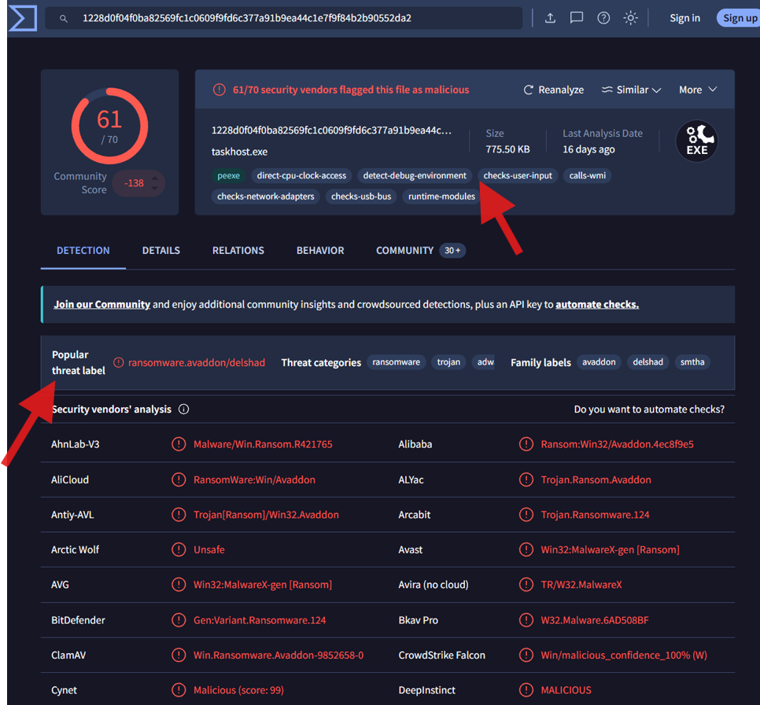
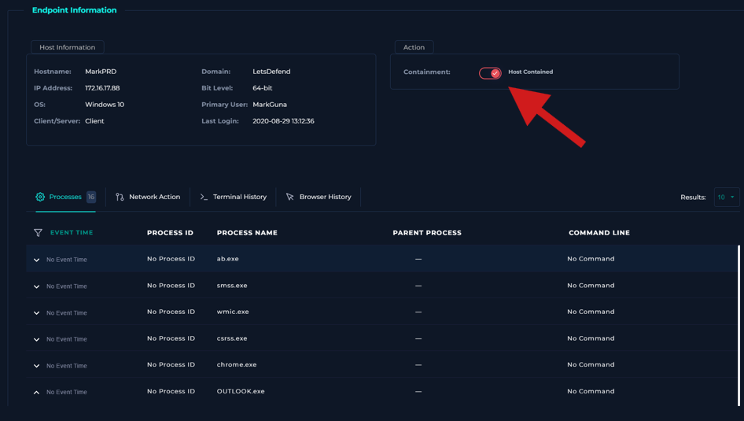

<body>
<h1>Possible MalDoc in PDF was Detected</h1>
<h2>Summary</h2>
!!!!!!!!!!!!!!!!!!!!!!!!!!!!!

<h2>Indicators of Compromise</h2>
<table>
    <thead>
        <tr>
            <th>Type</th>
             <th>Value</th>
              <th>Description</th>
        </tr>
    </thead>
    <tbody>
        <tr>
            <td>file hash</td>
            <td>098796e1b82c199ad226bff056b6310262b132f6d06930d3c254c57bdf548187</td>
            <td>Malicious file hash </td>
        </tr>
        <tr>
            <td>host IP address</td>
            <td>172[.]16[.]17[.]143</td>
            <td>attacked IP address </td>
        </tr>
    </tbody>
</table>

<h2>MITRE ATT&CK Mapping</h2>

T1566.001  - Spearphishing Attachment

T1204.002 -User Execution: Malicious File

T1001  - Data Obfuscation

<h2>Investigation & Containment Actions</h2>

1. Through Virustotal, I confirmed this hash is malicious and learned taskhost[.]exe is a typical type of malware. This threat is most likely ransomware related as labeled. 　From the behavioral analysis section as marked, I noted “detect-debug-environment” & “checks-user-input” that I learned these tags are designed to avoid the sandbox environment and debugging environments.

2. Since I found the ab[.]exe file is malicious, immediately I containmented the MarkPRD endpoint and terminated taskhost[.]exe.

<h2>Final status - True Positive </h2>

I would like to escalate this case to my senior tier 2 soc analyst to investigate deeper.
Given the high confidence confirmation of ransomware, not only the containment action but also further actions such as forensic investigation followed by full OS re-imaging of the affected host device would make sense. For compliance and legal perspective, we need to evaluate local law regulations regarding potential data breach assessments and Chain of Custody for all preserved artifacts.

</body>
