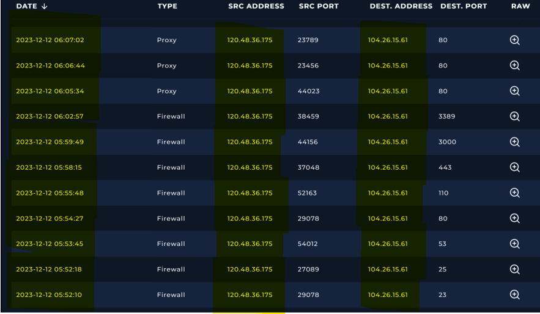
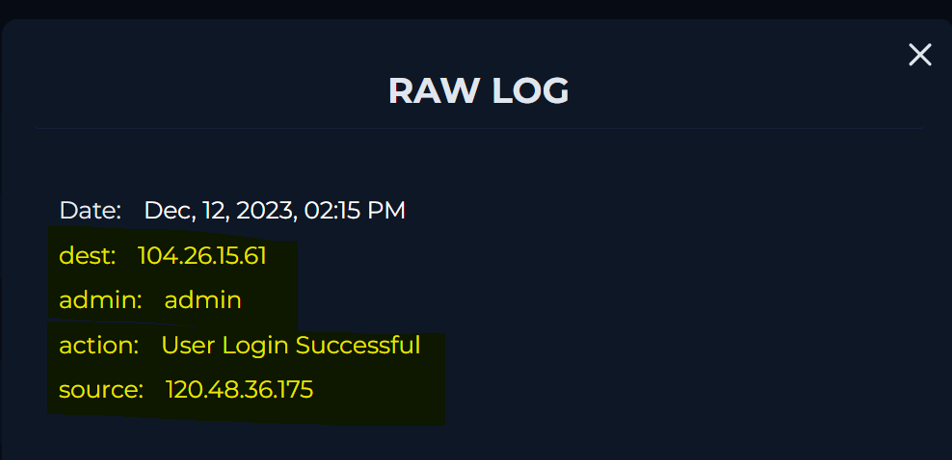
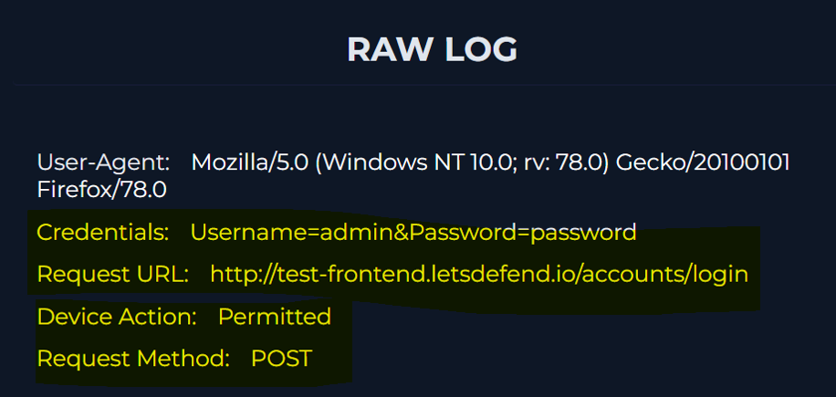
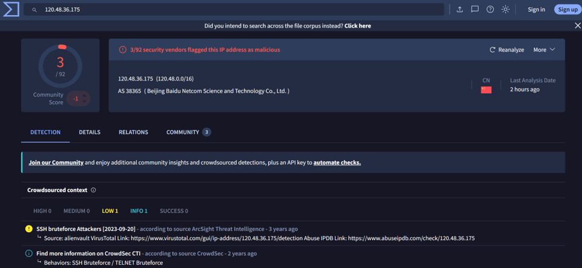
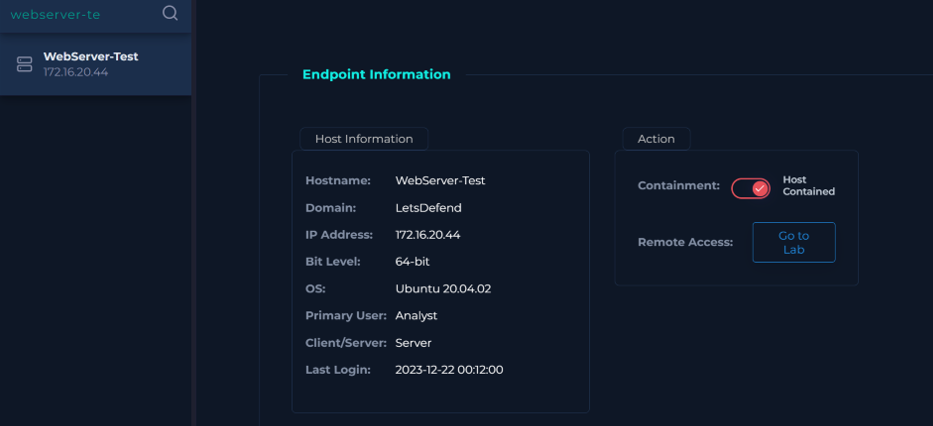

<body>
<h1>Forced Authentication Detected through Brute Force</h1>
<h2>Summary</h2>

Observed signs of brute-force activity, and upon further investigation, discovered an unauthorized successful login. Promptly isolated the endpoint and executed containment measures.

<h2>Indicators of Compromise</h2>
<table>
    <thead>
        <tr>
            <th>Type</th>
             <th>Value</th>
              <th>Description</th>
        </tr>
    </thead>
    <tbody>
        <tr>
            <td>source IP address</td>
            <td>120[.]48[.]36[.]175</td>
            <td>malicious IP address </td>
        </tr>
        <tr>
            <td>destination IP address</td>
            <td>104[.]26[.]15[.]61</td>
            <td>attacked IP address </td>
        </tr>
         <tr>
      <td>endpoint URL</td>
      <td>hxxp://test-frontend[.]letsdefend[.]io/accounts/login</td>
      <td>Targeted endpoint URL </td>
    </tr>
    </tbody>
</table>

<h2>MITRE ATT&CK Mapping</h2>

T1187 - Forced Authentication

T1110.001 - Brute Force: Password Guessing

<h2>Investigation & Containment Actions</h2>

1. Investigated source IP address into the log management portal and found this brute force signs which same source IP (120.48.36.175) attemped to login to same destination IP address (104.26.15.61) various times in a few minutes. (2023-12-12)

2. With further investigations, found an unetical login attempt targeting admin was succeded.

- This second raw log shows that from this Request URL, the attacker attempted to login with the credential information as below and Firewall permitted this malicious request. 

3. Through Virustotal, the source IP address (120[.]48[.]36[.]175) was confirmed as malicious, and the target IP address was confirmed as clean.

4. Excuted a containment action in order to stop further spread of damage at endpoint section. 

<h2>Final status - True Positive </h2>

Though took a containment action at the end point section, more actions such as resetting compromised credentials, adjusting firewall’s setting, and mitigation measures like account lockout policies and stronger password setting would be recommended as escalating to level 2 senior security analysts.

</body>