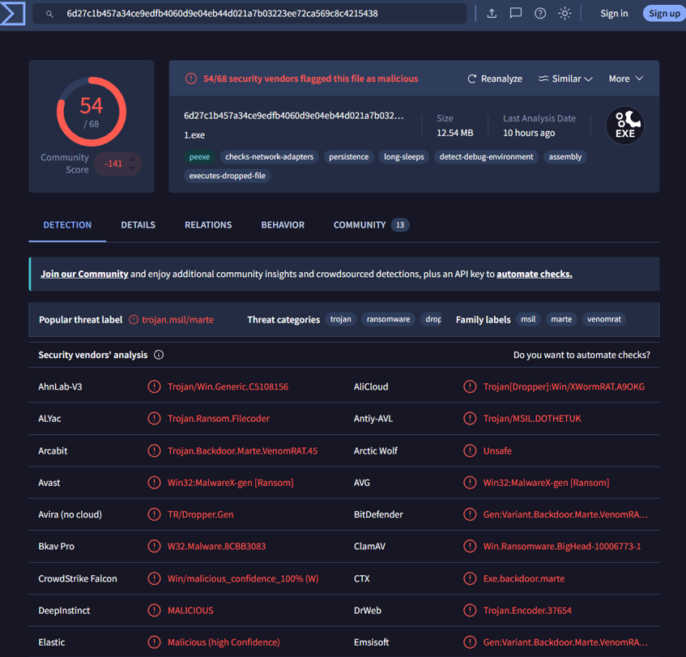
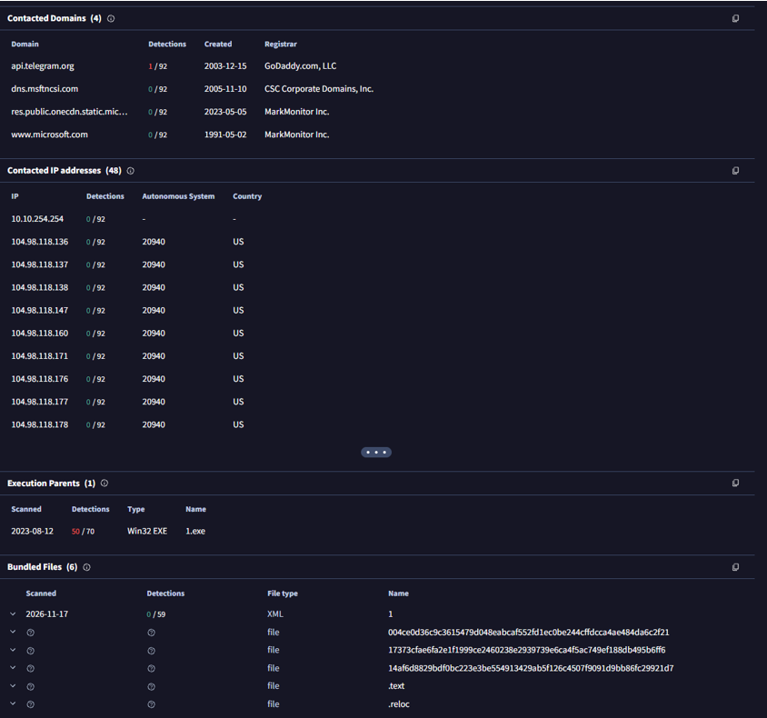
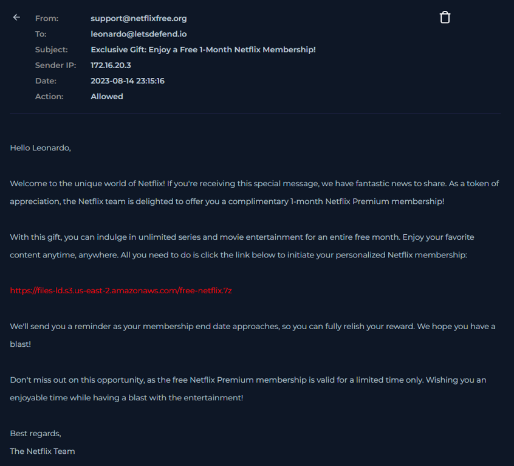
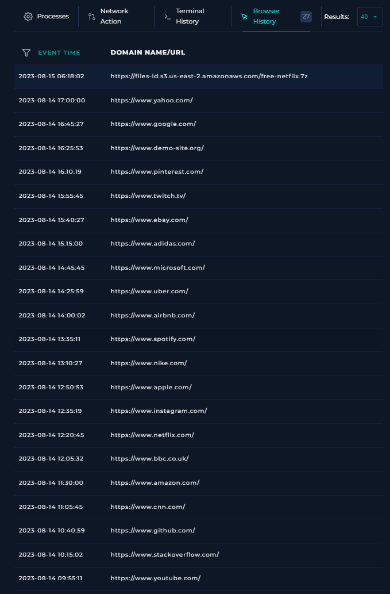
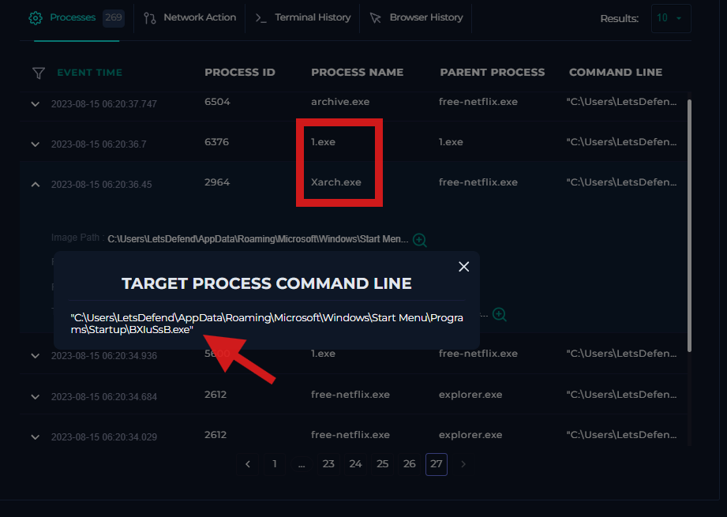
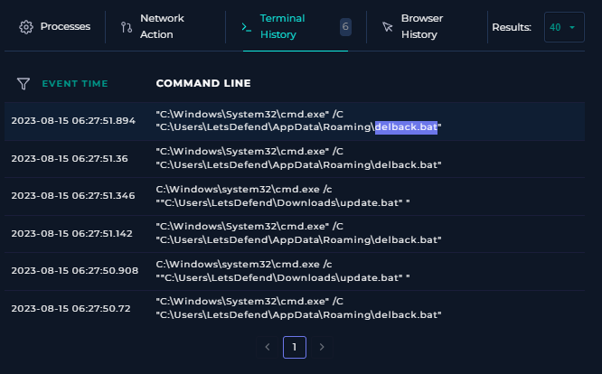
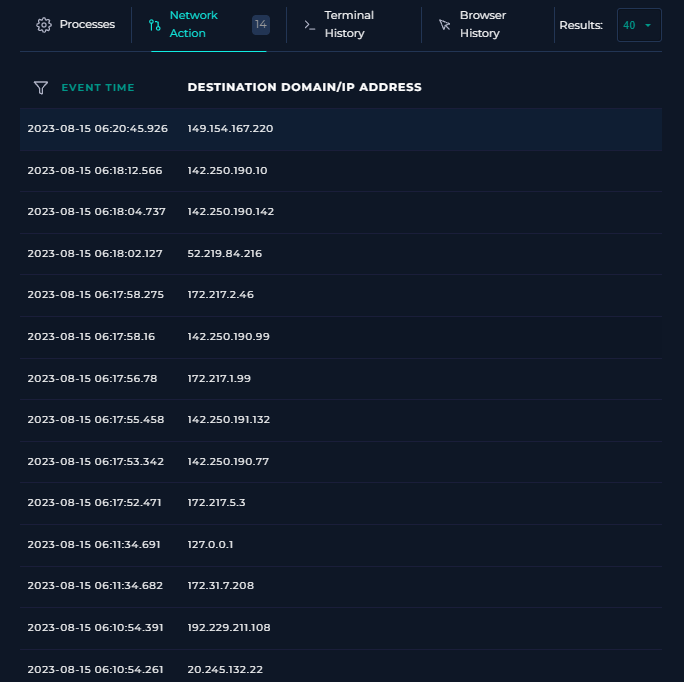
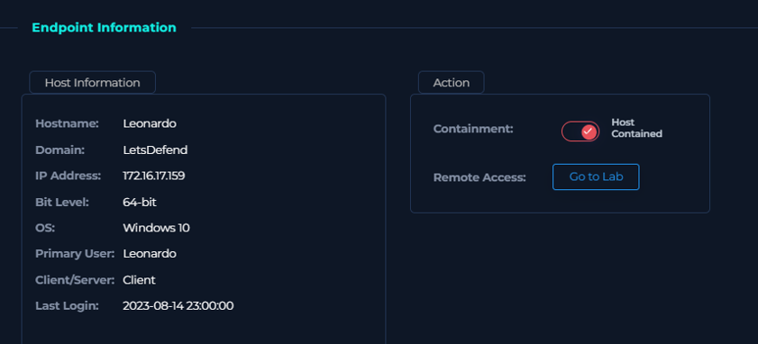

<body>
<h1>Big Head Ransomware IOC's Detected</h1>
<h2>Summary</h2>

On August 15, 2023, a True Positive Big Head Ransomware was confirmed on host Leonardo after the user accessed a phishing link from support@netflixfree[.]org.
While reviewing endpoint and network logs verified persistence in the Windows Startup folder, I found some backup deletions attempted via delback[.]bat and update[.]bat, and active C2 communication with Telegram infrastructure. The affected endpoint was immediately contained to prevent further impact.

<h2>Indicators of Compromise</h2>
<table>
    <thead>
        <tr>
            <th>Type</th>
             <th>Value</th>
              <th>Description</th>
        </tr>
    </thead>
    <tbody>
        <tr>
            <td>source IP address</td>
            <td>172[.]16[.]17[.]159</td>
            <td>Compromised Leonardo’s endpoint IP address  </td>
        </tr>
        <tr>
            <td>destination IP address</td>
            <td>149[.]154[.]167[.]220</td>
            <td>External C2 IP address belonging to Telegram </td>
        </tr>
         <tr>
      <td>domain</td>
      <td>api[.]telegram[.]org</td>
      <td>Telegram Bot API domain abused for C2 communication </td>
    </tr>
         <tr>
      <td>malicious attached file</td>
      <td>free-netflix[.]7z</td>
      <td>Malicious attached file delivered via spear phishing email  </td>
    </tr>
         <tr>
      <td>executable file</td>
      <td>free-netflix[.]exe</td>
      <td>Initial malicious executable launched on host Leonardo  </td>
    </tr>
         <tr>
      <td>executable file</td>
      <td>1[.]exe</td>
      <td>Second malicious executable linked to ransomware payload  </td>
    </tr>
         <tr>
      <td>batch script</td>
      <td>delback[.]bat</td>
      <td>Malicious batch script executed to delete backups and inhibit recovery  </td>
    </tr>
         <tr>
      <td>batch script</td>
      <td>update[.]bat</td>
      <td>Malicious batch script executed sequentially via cmd.exe  </td>
    </tr>
         <tr>
      <td>file path</td>
      <td>
C:/Users/LetsDefend/AppData/Roaming/Microsoft/Windows/Start Menu/Programs/Startup/
</td>
      <td>Windows Startup folder path abused for persistence  </td>
    </tr>
    </tbody>
</table>

<h2>MITRE ATT&CK Mapping</h2>
<table>
    <thead>
        <tr>
            <th>Tactic</th>
             <th>Technique ID</th>
              <th>Technique Name</th>
              <th>Observed Evidence in the investigation</th>
        </tr>
    </thead>
    <tbody>
        <tr>
            <td>Initial Access </td>
            <td>T1566.002</td>
            <td>Phishing: Spearphishing Link   </td>
            <td>A fake email pretending to be official Netflix support (support@netflixfree[.]org) arrived, and a cloud link (files-ld[.]s3[.]us-east-2[.]amazonaws[.]com) was pasted inside it to have the recipient download a virus-infected compressed file (free-netflix[.]7z).  </td>
        </tr>
        <tr>
            <td>Execution </td>
            <td>T1204.002</td>
            <td>User Execution: Malicious File   </td>
            <td>User downloaded and executed free-netflix[.]exe on host Leonardo (172[.]16[.]17[.]159).   </td>
        </tr>
        <tr>
            <td>Execution </td>
            <td>T1059.003</td>
            <td>Command and Scripting Interpreter: Windows Command Shell   </td>
            <td>cmd[.]exe was invoked repeatedly to run malicious batch scripts (delback[.]bat and update[.]bat).   </td>
        </tr>
        <tr>
            <td>Persistence </td>
            <td>T1547.001</td>
            <td>Boot or Logon Autostart Execution: Registry Run Keys / Startup Folder   </td>
            <td>Malicious executable (1[.]exe) was placed and launched inside C:/Users/LetsDefend/AppData/Roaming/Microsoft/Windows/Start Menu/Programs/Startup/   </td>
        </tr>
        <tr>
            <td>Command and Control </td>
            <td>T1102</td>
            <td>Web Service   </td>
            <td>Infected host established outbound HTTPS communication with Telegram infrastructure (149[.]154[.]167[.]220 / api[.]telegram[.]org).   </td>
        </tr>
        <tr>
            <td>Impact </td>
            <td>T1490</td>
            <td>Inhibit System Recovery   </td>
            <td>Repeated execution of C:/Users/LetsDefend/AppData/Roaming/delback[.]bat　to delete system backups and prevent recovery.   </td>
        </tr>
       </tbody>
</table>

<h2>Investigation & Containment Actions</h2>

1.	Initial Detection & File Analysis:

After checking the alert details, I investigated the malicious hash file at first. This is registered as malicious file by 54 out of 68 vendors as below.

And as I looked into the relations tab, though I don’t see suspicious IP addresses , I see one possible malicious domain as “api[.]telegram[.]org”. Also from Execution Parents section, this payload is linked to a parent file named “1[.]exe”, flagged by 50 out of 70 security vendors which indicates the possibility of launching the main ransomware payload. 

2.	Initial Access (Phishing):
Next, I looked for any related E-mail with “free-netflix.7z” and found this malicious possible spearphishing linked E-mail. I find this E-mail has not been blocked and allowed straightly into Leonardo’s inbox.

3.Execution & Persistence (Startup Folder):
To assess the extent of the impact, I accessed the targeted host Leonardo’s endpoint (172[.]16[.]17[.]159) and checked whether the suspicious URL had been visited. I confirmed that there was already a record of access to the URL. Reviewing the process history on Leonardo, I also verified that free-netflix[.]exe was executed, followed by malicious executables (1[.]exe, Xarch[.]exe, and BXIuSsB[.]exe) being launched inside the Windows Startup folder (C:/Users/LetsDefend/AppData/Roaming/Microsoft/Windows/Start Menu/Programs/Startup/).Because Windows has a built in feature that automatically launches all programs placed inside this Startup folder upon user login, placing these files there establishes persistence on the device. 

4.System Recovery Inhibition @ Terminal History :
Next, I checked the Terminal History section in Endpoint Security and found that “delback[.]bat” appeared four times within a minute, as well as “update[.]bat,” which indicates that cmd[.]exe was used to execute multiple malicious batch scripts sequentially. After researching this further, I confirmed that these commands indicate attempts to delete backups and inhibit system recovery, which is a typical behavior of ransomware activity.
 

5.Command and Control @ Network Action:
While the Network Action log recorded the destination as an IP address (149[.]154[.]167[.]220), looking it up confirmed that it belongs to Telegram. This matches the contacted domain (api[.]telegram[.]org) previously identified in the VirusTotal malware analysis in Step 1, confirming active C2 communication via Telegram from the infected host. Threat actors frequently abuse legitimate services like Telegram because the traffic blends into standard HTTPS activity and is less likely to be blocked than a dedicated malicious server, allowing them to receive infection notifications or exfiltrate data covertly.
 

<h2>Final status - True Positive </h2>

Based on these confirmed findings, the alert was classified as a True Positive, and containment was immediately performed on host Leonardo to isolate the endpoint and prevent further impact. I would like to escalate this alert for further investigation such as host-level forensic investigation, checking for encrypted files, and full host remediation.

</body>
