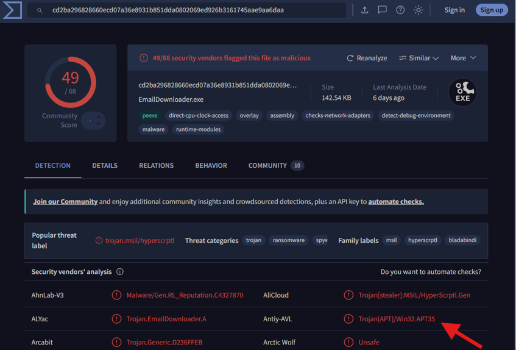
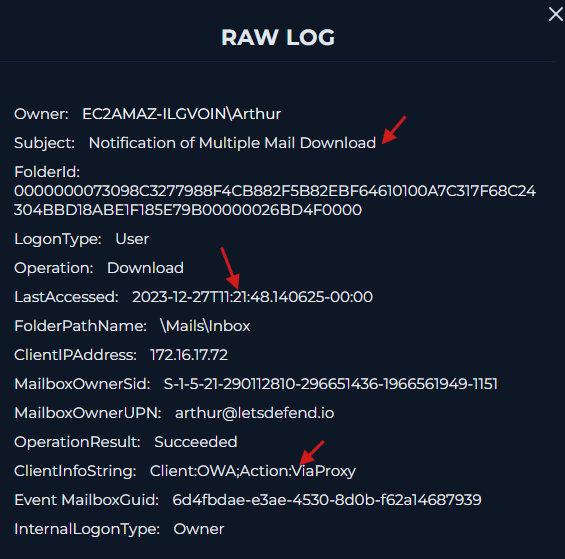
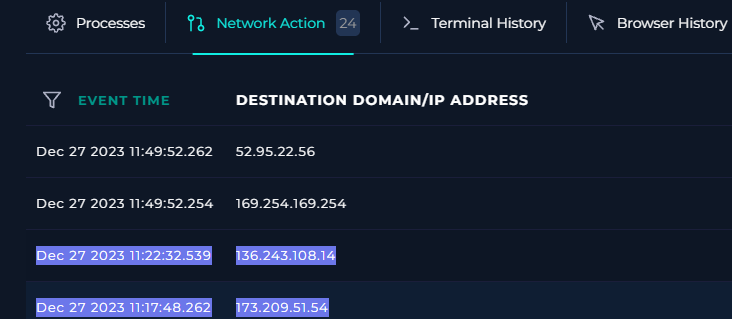
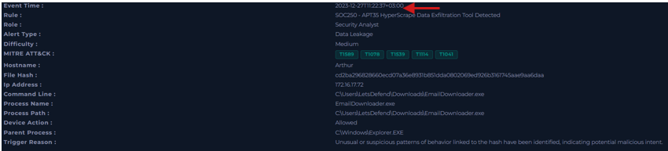
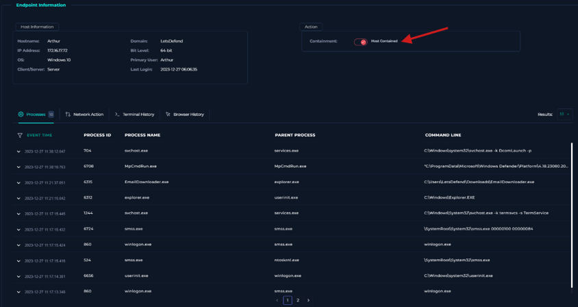

<body>
<h1>APT35 HyperScrape Data Exfiltration Tool Detected</h1>
<h2>Summary</h2>

I performed a containment of Arthur’s endpoint since I found there were multiple signs of malicious incidents regarding the data exfiltration such as malicious hash, some unauthorized connections, and suspicious data file download.

<h2>Indicators of Compromise</h2>
<table>
    <thead>
        <tr>
            <th>Type</th>
             <th>Value</th>
              <th>Description</th>
        </tr>
    </thead>
    <tbody>
        <tr>
            <td>suspicious file hash</td>
            <td>`cd2ba296828660ecd07a36e8931b851dda0802069ed926b3161745aae9aa6daa
            `</td>
            <td>malicious hash </td>
        </tr>
         </tbody>
</table>

<h2>MITRE ATT&CK Mapping</h2>

T1589　 - Gather Victim Identity Information

T1078　 - Valid Accounts

T1539　 - Steal Web Session Cookie

T1114　 - Email Collection

T1041   - Exfiltration Over C2 Channel

<h2>Investigation & Containment Actions</h2>

1. Through Virustotal, I confirmed this hash was malicious and learned about APT35 as a severe risk. 

2.Next, I researched the host’s (Arthur’s) IP address at log management and found this raw log:

a. The subject tells us not only did someone read Arthur’s E-mail, but they also downloaded multiple E-mails. And from “Operation Result”, it tells us that this was successful.  

b. From ‘ViaProxy’, we can see the attacker attempted to hide their own information and trace with using proxy where you can relay servers. 

3. Upon further investigation into the Arthur’s endpoint, I found the correlated timelines below:

<table>
    <thead>
        <tr>
            <th>Time</th>
             <th>IP address</th>
              <th>Description</th>
        </tr>
    </thead>
    <tbody>
        <tr>
            <td>Dec 27 2023 11:17:48.262</td>
            <td>173[.]209[.]51[.]54    </td>
            <td>An unauthorized inbound connection was established from an external suspicious IP address. </td>
        </tr>
        <tr>
            <td>Dec 27 2023 11:22:32.539</td>
            <td>136[.]243[.]108[.]14    </td>
            <td>5 minutes later, an outbound HTTP connection was established to a suspicious external IP address from Arthur endpoint.  </td>
        </tr>
        <tr>
            <td>Dec 27 2023 11:22:37</td>
            <td>--- </td>
            <td>Immediately after this, the alert got triggered with sensing of the malicious file download activity. </td>
        </tr>
         </tbody>
</table>

4.Due to these malicious activities and elements, I containmented Arthur’s endpoint. 

<h2>Final status - True Positive </h2>

I would like to escalate this case to my senior tier 2 soc analyst to investigate deeper.
Since APT35 threat is obvious, not only the containment action but also further actions such as forensic investigation and lateral movement research would make sense.
Also I recommend disabling the targeted account arthur[at]letsdefend[.]io and resetting the account as well as confirming any potential data leakage and report to the executive management .
For a compliance perspective, considerations for evaluation regarding some law or regulations, breach notifications, or legal hold would also make sense.

</body>
