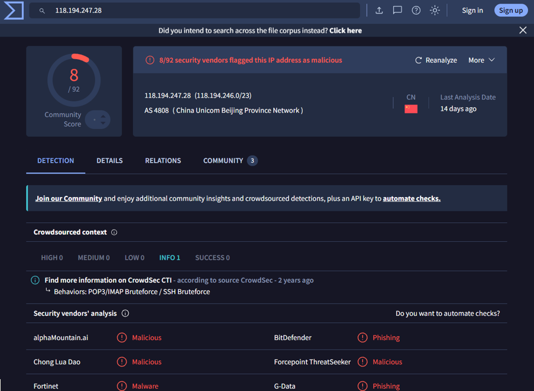
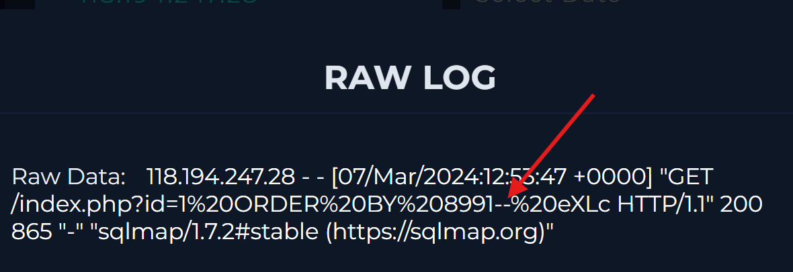
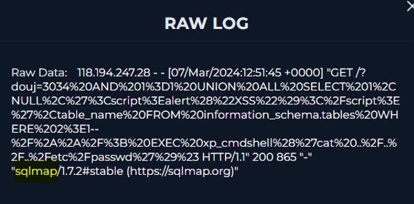
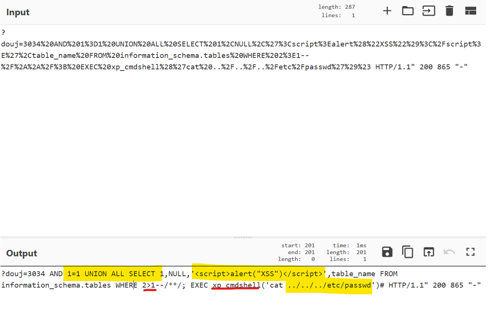
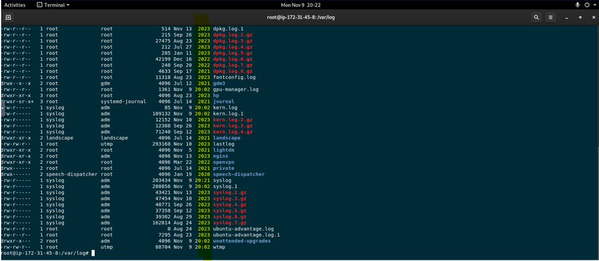
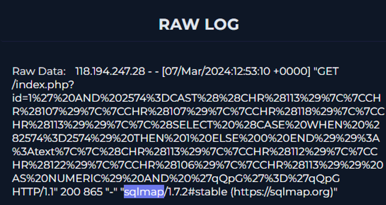

<body>
<h1>SQL Injection Detected</h1>
<h2>Summary</h2>

I observed signs of SQL injection activity, and upon further investigation, I discovered automated sqlmap attacks (118[.]194[.]247[.]28) including SQLi, XSS. The server incorrectly returned 200 OK for malicious payloads, indicating WAF/defense failure.

<h2>Indicators of Compromise</h2>
<table>
    <thead>
        <tr>
            <th>Type</th>
             <th>Value</th>
              <th>Description</th>
        </tr>
    </thead>
    <tbody>
        <tr>
            <td>source IP address</td>
            <td>118[.]194[.]247[.]28</td>
            <td>malicious IP address </td>
        </tr>
        <tr>
            <td>malicious URL</td>
            <td>GET /? douj=3034%20AND%201%3D1%20UNION%20ALL%20SELECT%201%2CNULL%2C%27%3Cscript%3Ealert%28%22XSS%22%29%3C%2Fscript%3E%27%2Ctable_name%20FROM%20information_schema[.]tables%20WHERE%202%3E1--%2F%2A%2A%2F%3B%20EXEC%20xp_cmdshell%28%27cat%20..%2F..%2F..%2Fetc%2Fpasswd%27%29%23 HTTP/1.1</td>
            <td>Malicious request payload </td>
        </tr>
    </tbody>
</table>

<h2>MITRE ATT&CK Mapping</h2>

T1595　- Active Scanning

T1133　- External Remote Services

T1190　- Exploit Public-Facing Application

T1552.001 - Unsecured Credentials: Credentials In Files

<h2>Investigation & Containment Actions</h2>

1.I checked the source IP is malicious through VirusTotal. (Threat tool from letsdefend did not detect any information.)

2. nitial Investigation for the source IP address into Log Management and found some signs for the SQL injection (% , -- ).

3. Looking further into this log information, I found this raw log that shows some suspicious keywords and through cyberchef, confirmed three signes regarding to SQL injections as below: 

 a "1=1"   
this is one of the severe signs for the SQL injection since this means the application would excute commands under any conditions.
 

 b "UNION ALL SELECT"  
This is another malicious sign since it allows unauthorized data to be accessed. In this scenario, sensitive information that is not meant for the public is added to the public response, allowing attackers to view important or private data.

 c [<]script[>]alert("XSS")[<]/[>]  
With this code, they would simply pop the alert “XSS” on the screen, but this code actually has some serious possible risks as XSS (Cross Site Scripting) vulnerability. 
If this code works, it proves the system has a severe XSS vulnerability that let attackers run any JavaScript in the browser.

 d 'cat ../../../etc/passwd'  
From this pass traversal indication, we can see that the attacker attempted to access to password folder as sensitive system file which is multiple layers away from current location.

4. The same raw log also shows the server responded successfully (200 OK, 865 bytes) which was supposed to be blocked by firewall. To figure out the details of what the 865 bytes was responding to, I investigated the endpoint logs. 
As I was investigating the endpoint (var/log/) I found that the last log activity was 2023, not 2024 which is supposed to be recorded since this alert got triggered 2024.
  

5. With further investigation at log management, I found many automatic requests executed by sqlmap that should have been blocked yet responded successfully as indicated with a 200. This means either the firewall did not work properly or the setting was configured incorrectly.

<h2>Final status - True Positive </h2>

Although the endpoint device was contained this case must still be escalated to a tier 2 senior analyst for further investigation and mitigation.
As part of the impact analysis of the investigation, performing research on the other access logs on the targeted host IP address to see if there are any suspicious indicators from the malicious source IP address and any actual traces of file leakage would make sense.
Also for mitigation, it would be recommended to urgently reassess the perimeter firewall and WAF security policies especially as it relates to sqlmap, path traversal. 

</body>