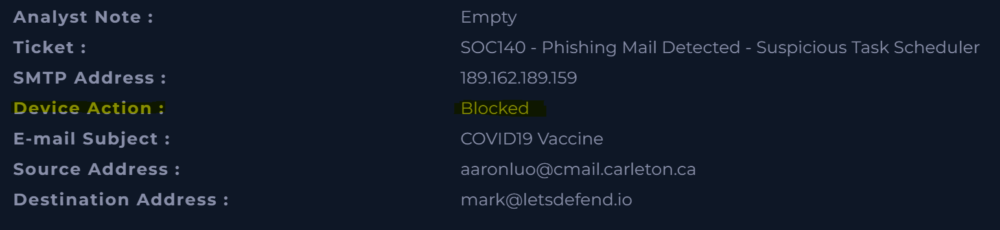
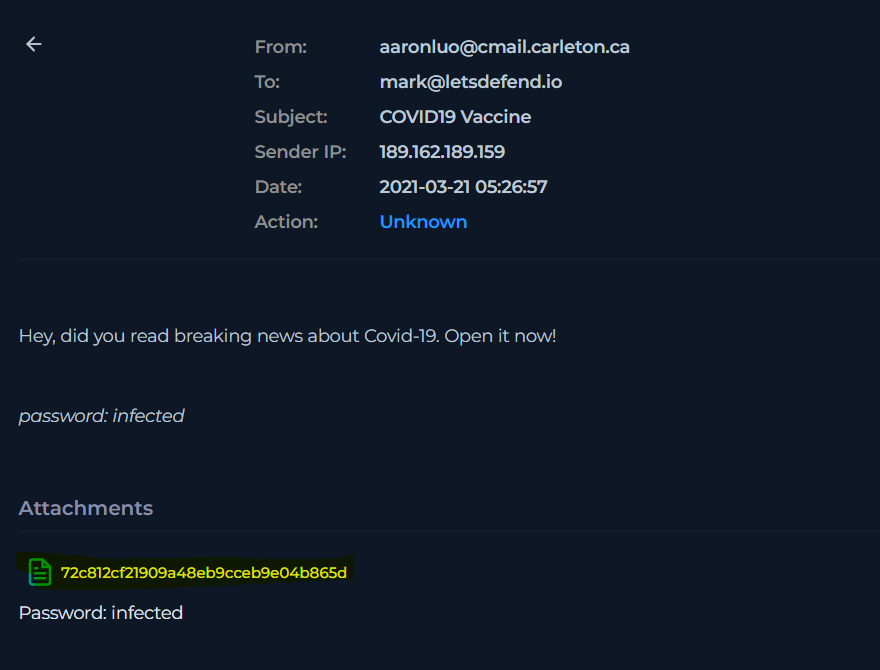
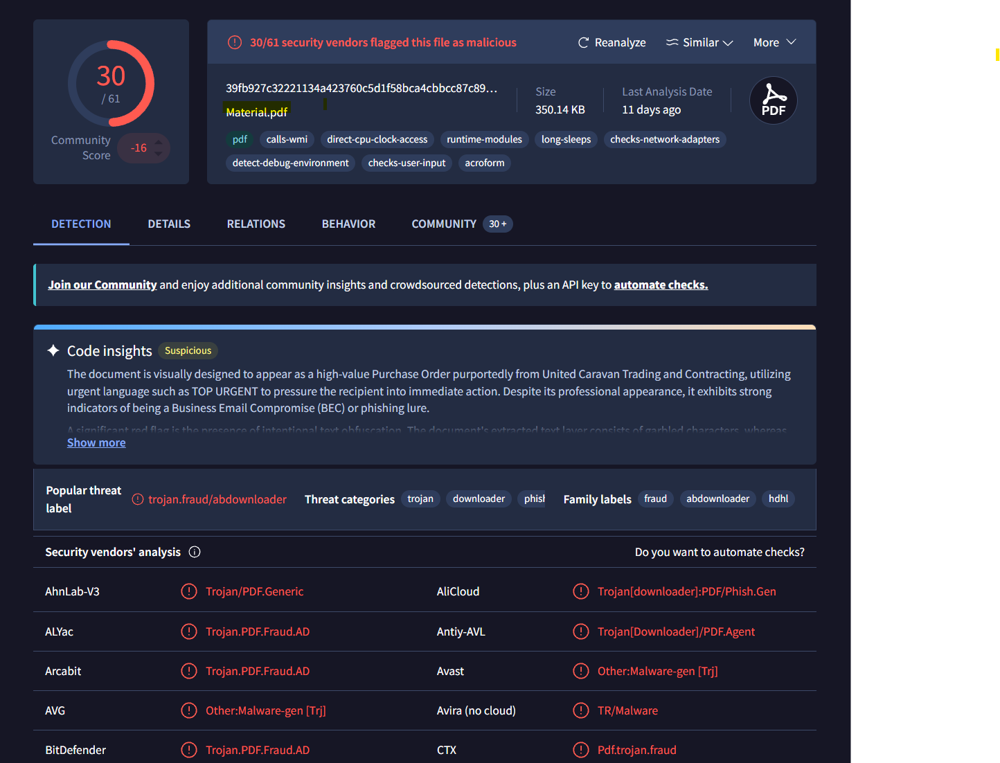
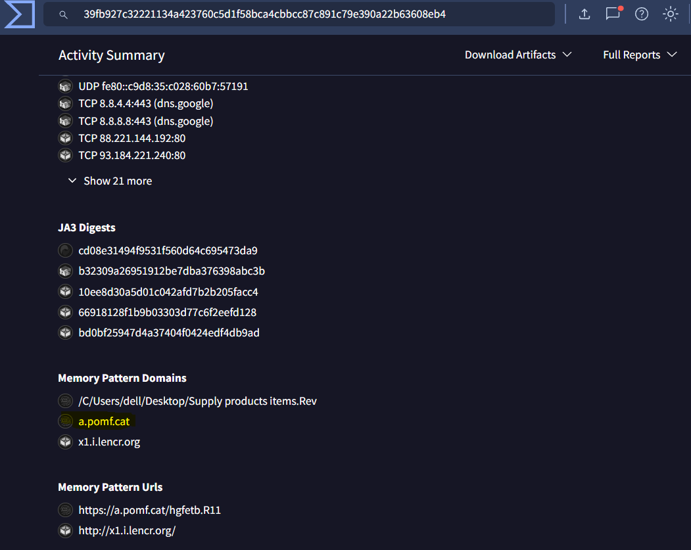
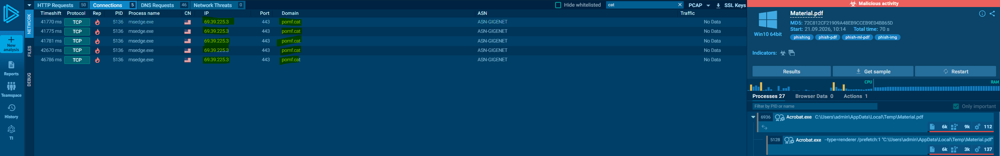
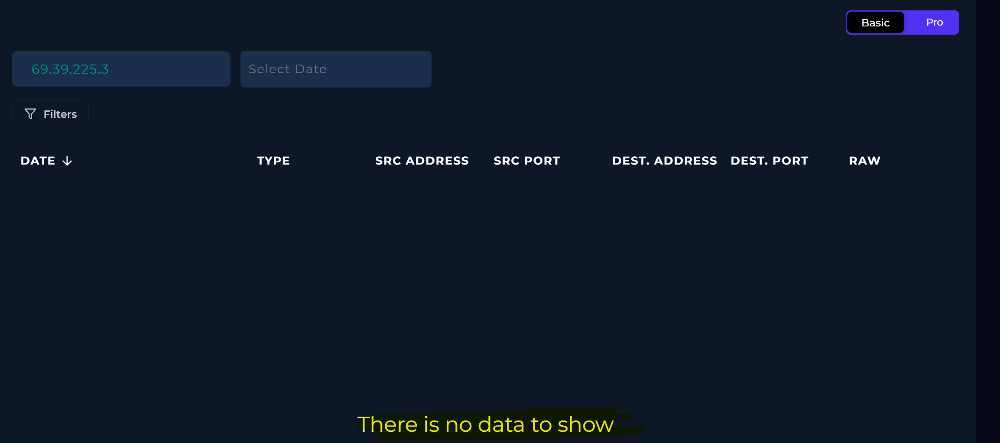

<body>
<h1>Phishing Mail Detected - Suspicious Task Scheduler</h1>
<h2>Summary</h2>

Email from aaronluo@cmail.carleton.ca to mark@letsdefend.io triggered this alert and was blocked by the email security control. The email contained a PDF attachment. The attachment was analyzed in VirusTotal MD5 (39fb927c32221134a423760c5d1f58bca4cbbcc87c891c79e390a22b63608eb4) and is classified as Trojan.PDF. Dynamic analysis in Any.run showed the PDF attempts to contact C2 infrastrucuture at 69.39.225.3 (a.pomf.cat) which is confirmed malicious in VirusTotal.　Log management shows no outbound connections to the C2 address and the alert indicates the action was blocked so it is safe to assume the PDF was not opened and threat was contained.

or

Investigated a phishing email carrying a malicious file attachment " Trojan.PDF" targeting "mark@letsdefend.io". The email was automatically blocked at the perimeter, and telemetry analysis confirmed zero outbound C2 connections, fully containing the threat with no host compromise.

<h2>Indicators of Compromise</h2>
<table>
    <thead>
        <tr>
            <th>Type</th>
             <th>Value</th>
              <th>Description</th>
        </tr>
    </thead>
    <tbody>
        <tr>
            <td>Attacker's Email Address</td>
            <td>aaronluo@cmail.carleton.ca</td>
            <td>malicious PDF file attached </td>
        </tr>
        <tr>
            <td>MD5</td>
            <td>39fb927c32221134a423760c5d1f58bca4cbbcc87c891c79e390a22b63608eb4</td>
            <td>classified as Trojan.PDF in VirusTotal </td>
        </tr>
         <tr>
      <td>C2 IP Address domain</td>
      <td>a.pomf.cat</td>
      <td>Dynamic analysis in Any.run showed the PDF attempts to contact C2 infrastrucuture </td>
    </tr>
     <tr>
      <td>C2 IP Address </td>
      <td>69.39.225.3</td>
      <td>Dynamic analysis in Any.run showed the PDF attempts to contact C2 infrastrucuture </td>
    </tr>
    </tbody>
</table>

<h2>MITRE ATT&CK Mapping</h2>

T1566.001 - Phishing: Spearphishing Attachment

T1071.001 - Application Layer Protocol: Web Protocols

<h2>Investigation & Containment Actions</h2>

1. Email security control automatically blocked this malicious email from aaronluo@cmail.carleton.ca

2. Checked email attached file

3. Investigated the MD5 hash via VirusTotal and confirmed that this file is malicious material.pdf as Trojan.PDF. 

 - Wirh further investigation, found the suspicious domain as "a.pomf.cat". 

4. Investigated the MD5 hash via ANY.RUN as dynamic research and found C2 IP address as 69.39.225.3  

Verified that no outbound connections were established to the C2 infrastructure via log management (69.39.225.3 / a.pomf.cat from ANY.RUN)

<h3>Final status - True Positive </h3>

Confirmed the threat was fully contained with zero evidence of host compromise.

Targeted host "Exchange Server" has been verified safe.

</body>